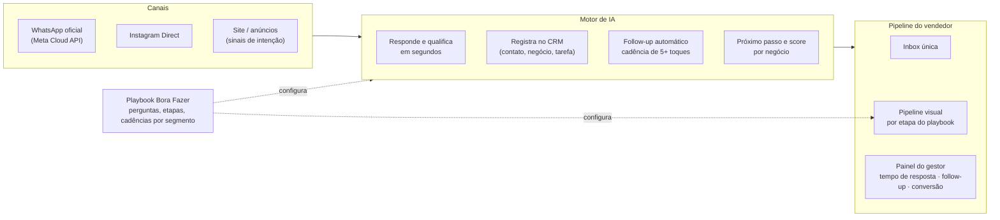
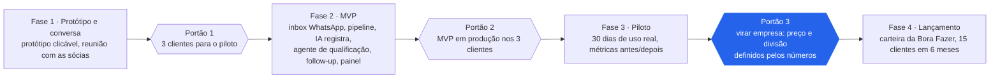

# Proposta Bora Fazer — Plataforma de Vendas com IA

Oct 22, 2026 · @Rodrigo Zaneti

Proposta de parceria: a Bora Fazer leva método e carteira de clientes, você leva o software — uma plataforma de vendas com IA para PMEs que resolve o que a RD Station deixa em aberto.

## Por que a Bora Fazer

A Bora Fazer já vende exatamente o que esse software precisa para ser adotado: processo comercial, marketing e execução "junto com" o empreendedor. O que falta a elas é um produto próprio que fique na empresa depois que a consultoria termina.

| O que elas têm | O que isso vale para o produto |
| --- | --- |
| Tatiane Soccol: Administração/Marketing (UFRGS), especialista em vendas com formação em CRM, 11+ anos corporativo | Dona do método comercial: define o playbook de vendas que a IA vai executar e vende a assinatura com credibilidade |
| Rafaela Reinehr: Administração (UFRGS), MBA Gestão de Projetos (FGV), Transformação Digital (BBI Chicago), fundou startup investida por VC | Entende produto digital, escala e investidor: parceira natural para roadmap, go-to-market e eventual captação |
| Serviço "Ação 360º" (Comercial, Marketing, Financeiro, Pessoas, Compras) e Marketing Digital com persona e metas | Já diagnosticam a dor de vendas do cliente; o software vira a entrega padrão do diagnóstico |
| Carteira de PMEs e startups em Porto Alegre, 35 avaliações Google "Excelente", contato via WhatsApp | Primeiros 10–20 clientes do MVP sem custo de aquisição; feedback real em semanas |
| Posicionamento "Nós executamos negócios", tom leve, "1% melhor por dia" | O produto deve ter a mesma cara: simples, mão na massa, resultado visível em dias (o oposto da RD Station "enterprise") |
| Histórico com você: indicação do cliente da clínica de banco de sêmen e projeto conjunto na V-Corp | Confiança já construída; a conversa é de sócios, não de fornecedor |

O argumento central para elas: consultoria vende horas e não escala; um software recorrente que carrega o método da Bora Fazer dentro dele transforma cada cliente de projeto em receita mensal, e cada implantação em case para o próximo cliente.

## O que as melhores plataformas do mundo fazem hoje

O mercado global convergiu para um padrão: copiloto grátis dentro do CRM, agentes de IA cobrados por uso, e o CRM se preenchendo sozinho a partir de e-mail, agenda e ligações. Ninguém combina isso com WhatsApp nativo e preço previsível para PME — essa é a lacuna.

| Plataforma | O que faz de melhor com IA | Preço (US$/usuário/mês) | Onde falha para a PME brasileira |
| --- | --- | --- | --- |
| [HubSpot Breeze](https://cxtoday.com/crm/hubspot-inbound-2025-the-top-10-announcements) | 15 agentes prontos: Prospecting Agent pesquisa a conta e envia outreach; Customer Agent resolve mais de 50% das conversas; assistente grátis em todos os planos | Starter 15–20, Pro 90–100 + US$1.500 de onboarding; agentes por crédito (US$0,50/conversa resolvida) | Scoring e forecast só no Pro; créditos acabam com uso pesado; tudo em inglês-first |
| [Salesforce Agentforce](https://www.eesel.ai/blog/agentforce-pricing) | Agente SDR que nutre e qualifica leads sozinho; forecast; Einstein scoring | Sales Cloud 25; IA completa passa de US$200/usuário; US$2 por conversa | Preço que "nem a Salesforce sabe explicar"; exige administrador |
| [Pipedrive](https://venturebeat.com/ai/pipedrive-brings-new-ai-powered-pulse-to-its-sales-crm) | Pulse ranqueia leads por probabilidade; assistente prioriza deals; gera e resume e-mails | 14–89 | Sem marketing, sem WhatsApp nativo, relatórios básicos |
| [Attio](https://www.stacksync.com/blog/attio-crm-2026-review-features-pros-cons-pricing) | CRM que se preenche a partir das ligações (BANT/MEDDPICC automático); campos enriquecidos por IA com pesquisa na web | Free, 29, 69 | Sem marketing; exige engenharia para integrar |
| [Clay](https://landbase.com/blog/clay-pricing) | Enriquecimento em cascata com 100+ fontes; agente de pesquisa (Claygent); sinais de mudança de cargo e intenção | 167–495/mês por workspace | Curva de aprendizado alta; créditos imprevisíveis; dados fracos para Brasil |
| [Gong](https://fritz.ai/gong-ai-review/) | Lê todas as calls, pontua o deal com 300+ sinais, dá coaching e atualiza o CRM | \~1.400–3.000/ano + plataforma US$5–50 mil | Enterprise; 8+ semanas de implantação |
| [Kommo](https://www.folk.app/articles/kommo-crm-for-whatsapp-review-features-alternatives-and-more) | CRM de mensageria: WhatsApp, Instagram e Telegram numa inbox; Salesbot com IA 24/7 | 15–45 | Automação exige técnico; WhatsApp só nos planos caros; IA rasa |
| [Apollo.io](https://www.joinvalley.co/blog/apollo-review-2026) | 240 milhões de contatos + assistente que monta lista, escreve e dispara por chat | Free, 49–119 | Dados ruins fora dos EUA; créditos expiram |

**O que a fronteira mostra (2025–2026).**

- O "SDR 100% autônomo" (11x, Artisan) passou do pico: a Artisan admitiu churn alto e alucinações na primeira geração, a 11x trocou de CEO. O que funciona é o agente que qualifica, agenda e faz follow-up com humano no fechamento ([TechCrunch](https://techcrunch.com/2025/04/09/artisan-the-stop-hiring-humans-ai-agent-startup-raises-25m-and-is-still-hiring-humans)).
- CRM "zero digitação": Attio, Gong e Clarify criam deals e tarefas a partir de e-mail, agenda e ligações; o vendedor só confirma. HubSpot e Pipedrive são criticados por não conseguirem isso por arquitetura antiga ([Breakcold](https://www.breakcold.com/blog/self-updating-crm)).
- Venda por sinal: Warmly dispara um agente quando o prospect visita a página de preços; Clay avisa quando o contato muda de emprego.
- Preço migrando de assento para uso e resultado: HubSpot cobra por lead trabalhado, Salesforce por conversa, Clarify libera assentos ilimitados e cobra crédito. A Gartner projeta 40% do gasto em SaaS por uso ou resultado até 2030 ([Deloitte](https://www.deloitte.com/global/en/insights/industry/technology/technology-media-and-telecom-predictions/2026/saas-ai-agents.html)). A crítica recorrente é a imprevisibilidade: a oportunidade é um híbrido com teto.
- Salesforce State of Sales 2026 (4.050 vendedores): vendedores gastam só 40% do tempo vendendo; quem usa agentes de prospecção tem 1,7x mais chance de ser alto desempenho ([Salesforce](https://www.salesforce.com/uk/news/stories/state-of-sales-report-announcement-2026/)).

**Números para o pitch.**

| Fato | Fonte |
| --- | --- |
| Lead respondido em até 5 minutos tem 21x mais chance de qualificar do que em 30 minutos | [Lead Response Management / InsideSales](https://verse.ai/blog/speed-to-lead-statistics) |
| Tempo médio de resposta B2B: 42 horas; só 37% respondem em 1 hora | Harvard Business Review, estudo com 2.241 empresas |
| 51% dos leads nunca são contatados; 44% dos vendedores desistem após 1 tentativa, e 80% das vendas exigem 5+ follow-ups | [InsideSales / agregadores](https://lonelyentrepreneur.com/lead-followup-gap/) |
| 78% compram de quem responde primeiro | LeadConnect |
| WhatsApp: 98% de abertura e 8–15% de conversão, contra 21,5% e 1,5–3% no e-mail | [Aurora Inbox, citando Meta/Gartner](https://www.aurorainbox.com/en/2026/03/01/whatsapp-business-2025-statistics/) |
| No Brasil, agentes autônomos no WhatsApp converteram 9%, igual a humanos, com custo por conversa até 4x menor; 25% das mensagens chegam fora do horário comercial | [Chat Commerce Report 2026, OmniChat](https://www.abcdacomunicacao.com.br/sem-horario-comercial-vendas-migram-para-o-whatsapp-e-ia-impulsiona-resultados-aponta-chat-commerce-report-2026/) |

Os números de speed-to-lead e follow-up vêm de estudos antigos, muito repetidos por blogs de fornecedores: use-os como indicativos, não como prova.

## Onde a RD Station e o mercado brasileiro deixam a PME na mão

A RD Station tem mais de 60 mil clientes e 2 mil agências parceiras, mas vende três produtos separados (Marketing, CRM, Conversas), cobra implantação obrigatória e deixa o WhatsApp oficial para um módulo de R$ 989/mês. A PME brasileira vende por WhatsApp (82% dizem que é o canal principal) e menos de 10% acham CRM importante: o problema não é falta de ferramenta, é ferramenta que não cabe no jeito que ela vende.

**Quanto custa a RD Station de verdade (R$, out/2026).**

| Produto | Planos | O que pesa para a PME |
| --- | --- | --- |
| [RD Marketing](https://www.rdstation.com/blog/marketing/planos-precos-rd-station-marketing/) | Light 50 (só 3 meses, 1.000 contatos) · Basic 309 · Pro 1.121 + implantação 1.499 · Advanced 1.699 + 1.999 | Preço sobe com contatos; lead scoring e automação avançada só no Pro; contrato de 12 meses |
| [RD CRM](https://www.rdstation.com/planos/crm/) | Free (4 usuários) · Basic 73/usuário · Pro 131/usuário (mín. 4) | WhatsApp é extensão do WhatsApp Web (não oficial, só desktop); telefone +94/usuário; implantação 849–1.999 |
| [RD Conversas](https://www.rdstation.com/planos/conversas/) | Basic 989 (500 clientes/mês) · Pro 2.699 | Ativação WhatsApp 1.999; integração chatbot com CRM 3.799; créditos Meta à parte; sem trial |

Uma PME com 4 vendedores que quer marketing + CRM + WhatsApp oficial paga na RD cerca de R$ 2.800/mês mais R$ 4.300 de implantação no primeiro ano.

**O que os clientes reclamam** ([Capterra](https://www.capterra.com/p/180098/RD-Station/reviews/), [B2BStack](https://www.b2bstack.com.br/product/rd-station-crm/avaliacoes?page=46), [Reclame Aqui](https://www.reclameaqui.com.br/resultados-digitais/cobranca-indevida-de-plano-pre-pago-apos-14-meses-sem-comprovacao-de-contratacao_67LdPm4EKF7Zv-2W/)):

- Preço escala com contatos e módulos empilhados; "plano mais barato é muito limitado"; pressão constante de upgrade.
- Baixa integração entre os próprios módulos; integrações externas levam semanas.
- Suporte só por chat e e-mail, 24–36 horas de resposta, nota 3,9 no Capterra.
- Implantação complicada (G2 indica 3 meses), tutoriais defasados, landing pages padronizadas.
- Cobranças indevidas e cancelamento difícil.

A Totvs reportou crescimento de 15% da RD no 3T25, abaixo do esperado pelo mercado, e atribuiu parte da desaceleração à mudança de cobrança do WhatsApp ([Suno](https://www.suno.com.br/noticias/totvs-3t25-erp-acelera-rd-station-mt/amp/)). É um líder sensível a preço e com pouco espaço para repasse.

**Concorrentes nacionais e o buraco entre eles.**

| Ferramenta | Preço (R$) | Foco | Onde falha |
| --- | --- | --- | --- |
| [Agendor](https://www.agendor.com.br/planos-precos/crm) | Grátis (3) · 59 · 83 · 156/usuário | CRM B2B simples, IA "Ava" atualiza o CRM | WhatsApp oficial em produto à parte (Chat, a partir de 299); sem marketing |
| [Ploomes](https://www.ploomes.com/planos) | 79 · 269/usuário (mín. 4) | B2B complexo, propostas, ERP | Caro para equipes pequenas; sem WhatsApp oficial no básico |
| [Ollow (ex-Moskit)](https://www.ollow.com.br/planos) | 699 a 2.499/mês por conversas | CRM dentro do WhatsApp com API oficial | Preço alto para micro; implantação paga |
| [PipeRun](https://crmpiperun.com/planos/) | Base 189,90 + usuários + módulos (IA 99,90; WhatsApp 99,90) | B2B consultivo | Custo total opaco; contrato 12 meses |
| [Kommo](https://www.kommo.com/br/precos/compare-planos/) | US$ 20–45/usuário | WhatsApp-first, Salesbot | Cobrança em dólar; suporte estrangeiro; bot só nos planos caros |
| [Zenvia](https://zenvia.com/precos/) | 600 a 3.900/mês + canal + setup 649–3.999 | Omnichannel, bots | Precificação confusa; integrações quebram (Capterra 4,1) |
| [HubSpot BR](https://www.jivochat.com.br/blog/ferramentas/melhores-ferramentas-de-crm-com-whatsapp-para-empresas-brasileiras-em-2026.html) | Starter \~225/mês; Marketing Pro \~3.994 + onboarding US$ 3.000 | Suíte completa | WhatsApp só no Professional; caro em reais |

Ninguém no Brasil entrega, no plano de entrada e em reais, WhatsApp oficial + pipeline + automação de marketing + IA que preenche o CRM. Quem tem WhatsApp-first (Kommo, Ollow) não tem marketing nem IA profunda; quem tem marketing (RD, HubSpot) cobra o WhatsApp à parte e caro.

**A dor real da PME** ([RD Panorama de Vendas 2026](https://www.rdstation.com/pesquisas/panoramas-rd-station/edicao-2025/vendas/cenario/), [Agendor](https://www.agendor.com.br/blog/crm-no-brasil/), [Sebrae](https://agenciasebrae.com.br/dados/whatsapp-se-consolida-nas-vendas-on-line-enquanto-facebook-e-lojas-proprias-perdem-folego/)):

- Uso de CRM caiu de 58% (2024) para 46% (2025); 38% usam planilha; 20% não usam nada. Motivo nº 1 para não ter CRM: falta de verba.
- Só 33% têm processo de vendas estruturado; 75% não bateram a meta em 2025; 62% não acompanham conversão por etapa.
- Principal motivo de perda: "cliente não responde" (38%). Isso é falha de follow-up, não de produto.
- O que o vendedor quer delegar à IA: follow-up e e-mails (62,9%) e registrar atividades no CRM (52,9%).
- 75% das empresas fazem o primeiro contato por WhatsApp; dentro do RD CRM, 89% das contas usam WhatsApp contra 24% e-mail.

**Custo do WhatsApp oficial (Meta Cloud API, regra desde 01/10/2026)**: cobrança por mensagem; 1.000 mensagens de serviço grátis por mês por número; marketing R$ 0,32, utilidade e serviço R$ 0,035 ([Agendor](https://www.agendor.com.br/blog/?p=56939)). Um produto novo pode repassar isso a custo, sem o markup de R$ 0,39–0,55 que RD e Zenvia aplicam.

**Programas de parceria** ([RD Partners](https://reportei.com/como-funciona-o-programa-de-parceria-da-rd-station), [HubSpot](https://www.hubspot.com/partners/solutions/details)): a RD paga comissão recorrente não pública, cobra taxa de entrada, exige certificação e penaliza a agência por 12 meses quando o cliente cancela (regra GDR). A HubSpot paga 20% de revenue share por até 3 anos, mas exige pacote de parceiro a partir de US$ 400/mês. Nenhum dos dois trata a consultoria como sócia do produto; os dois a tratam como canal.

## O produto: tese e posicionamento

Um sistema de vendas em que a IA faz o trabalho que o vendedor da PME não faz: responder o lead em segundos, registrar tudo, cobrar o follow-up e dizer o próximo passo. WhatsApp oficial no plano de entrada, preço previsível em reais, e o método da consultoria já configurado dentro.

**Nome provisório.** A definir com elas; vale algo que não soe como "CRM" (palavra que 90% das PMEs não acham importante). Direções: "Vendedor de IA", "Assistente comercial", ou um nome próprio curto.

**Para quem.** Empresas de 2 a 20 vendedores que vendem por WhatsApp: serviços, clínicas, educação, academias, B2B de ticket médio. Exatamente a carteira da Bora Fazer.

**Promessa.** "Nenhum lead fica sem resposta e nenhum vendedor precisa digitar no CRM." Mensurável em duas métricas que o cliente vê no painel desde o primeiro dia: tempo de primeira resposta e taxa de follow-up.

**Em que é diferente da RD Station.**

| RD Station | Este produto |
| --- | --- |
| Três produtos separados (Marketing, CRM, Conversas) | Um produto, uma inbox, um preço |
| WhatsApp oficial em módulo de R$ 989/mês + R$ 1.999 de ativação | WhatsApp oficial incluído, mensagens Meta repassadas a custo |
| Vendedor digita no CRM (e não digita) | IA registra contato, negócio e tarefas a partir da conversa |
| Automação que o cliente precisa montar | Follow-up e qualificação já prontos no playbook do segmento |
| Implantação obrigatória de R$ 1.499–3.799 por agência | Implantação pela Bora Fazer, incluída no primeiro mês, com IA fazendo a carga inicial |
| Preço escala por contatos | Preço por vendedor, com teto, sem surpresa |
| Suporte por chat em 24–36 h | Suporte humano por WhatsApp no mesmo dia |

A conversa entra por qualquer canal, o motor de IA trabalha nela antes de qualquer humano, e o que sobra para o vendedor é fechar; o playbook da Bora Fazer define como o motor se comporta em cada segmento.

## Recursos de IA que aumentam conversão

Cada recurso abaixo ataca uma dor medida nas pesquisas brasileiras, e os cinco primeiros formam o MVP. O impacto esperado vem dos benchmarks da seção global; trate como hipótese a validar no piloto.

| Recurso de IA | Dor da PME (dado) | O que faz | Impacto esperado |
| --- | --- | --- | --- |
| Resposta e qualificação em segundos no WhatsApp | 25% das mensagens chegam fora do horário; tempo médio de resposta B2B 42 h | Agente responde, faz 3–5 perguntas do playbook, classifica (quente/morno/frio) e agenda | Lead em até 5 min tem 21x mais chance de qualificar; agentes no WhatsApp BR converteram 9%, igual a humanos |
| CRM que se preenche sozinho | 52,9% dos vendedores querem delegar o registro no CRM; 80% ainda usam planilha | Lê a conversa (texto e áudio), cria contato, negócio, etapa e próxima tarefa; vendedor só confirma | Adoção do time: o motivo nº 1 de abandono de CRM desaparece |
| Follow-up automático com cadência | "Cliente não responde" é o motivo nº 1 de perda (38%); 44% desistem após 1 tentativa | Cadência de 5+ toques por canal, mensagem personalizada pelo histórico, para quando o lead responde | Recupera negócios que hoje morrem por silêncio |
| Próximo passo e score por negócio | 62% não acompanham conversão por etapa | Ranqueia o pipeline do dia, sugere a ação e o texto; alerta negócio parado | Vendedor gasta o tempo nos 20% que fecham (Pipedrive Pulse, HubSpot) |
| Resumo e coaching da conversa | Só 33% têm processo estruturado | Resume cada atendimento, aponta objeção não tratada e compara com o playbook | Gestor vê qualidade sem ouvir tudo (Gong, para PME) |
| Carga inicial por IA | Implantação de 3 meses na RD | Importa planilha, WhatsApp exportado e Instagram; monta funil e campos do segmento | Implantação em dias, não meses |
| Campanhas que escrevem a si mesmas | Automação avançada só no RD Pro (R$ 1.121) | Segmenta a base pelo comportamento e gera campanha WhatsApp/e-mail aprovada pelo dono | Reativação de base sem agência |
| Sinais de intenção | 78% compram de quem responde primeiro | Visita à página de preço, clique em anúncio ou reabertura de conversa disparam o agente | Venda por sinal (Warmly, Clay) ao alcance da PME |
| Painel em linguagem natural | 38% não sabem seu tempo de primeiro contato | "Quantos leads perdemos esta semana e por quê?" respondido com números do próprio funil | Gestor sem analista |
| Agente de voz (fase 2) | Mais de 60% desligam em vez de deixar recado | Atende ligação perdida, qualifica e agenda | Casos reportam +40% de conversão de demo (vendor-reported) |

**Como a IA fica barata e previsível.** Modelos pequenos para classificar e extrair (centavos por conversa), modelo grande só para redigir; cota mensal de conversas por plano com teto, sem créditos que acabam no meio do mês. A reclamação mais comum contra HubSpot, Salesforce e Clay é justamente o crédito imprevisível.

**Humano no fechamento.** O agente qualifica, agenda e cobra; quem negocia e fecha é o vendedor. É o modelo que sobreviveu à primeira onda de AI SDR, e é o que a Bora Fazer consegue ensinar.

## MVP: o que entra, o que fica fora, 90 dias

O MVP prova uma coisa só: que um lead de WhatsApp vira negócio registrado, respondido e acompanhado sem o vendedor digitar. Tudo que não serve a essa prova fica para depois.

**Entra no MVP.**

1. Inbox com WhatsApp oficial (Meta Cloud API) e número do cliente; Instagram Direct se der tempo.
2. Pipeline visual com etapas do playbook do segmento, pré-configurado pela Bora Fazer.
3. IA que registra: lê cada conversa (texto e áudio transcrito), cria ou atualiza contato e negócio, move de etapa e cria a próxima tarefa; o vendedor confirma com um toque.
4. Agente de qualificação: responde em segundos fora do horário ou quando ninguém pega, faz as perguntas do playbook, classifica e oferece agenda.
5. Follow-up automático: cadência de até 5 toques para lead sem resposta, com texto gerado a partir do histórico, pausada assim que o lead responde.
6. Painel do gestor: tempo de primeira resposta, leads sem contato, follow-ups feitos, negócios parados, conversão por etapa.
7. Carga inicial por IA: importa planilha ou export do WhatsApp e monta a base.

**Fica fora (fase 2).** Agente de voz, construtor de landing pages, e-mail marketing completo, integração com ERP, app nativo (o MVP é web responsivo), propostas e cobrança Pix, sinais de intenção do site.

**O que medir no piloto (3 clientes, 30 dias de uso real).**

| Métrica | Antes (levantar no cliente) | Meta do piloto |
| --- | --- | --- |
| Tempo médio de primeira resposta | horas | menos de 5 minutos |
| Leads sem nenhum contato | % | zero |
| Toques de follow-up por lead | \~1 | 3 ou mais |
| Reuniões ou visitas agendadas por semana | n | +30% |
| Dias por semana em que cada vendedor usa o sistema | n | 5 |
| Horas de digitação no CRM por vendedor | h | perto de zero |

Cada fase termina num portão decidido com as sócias; o último é a decisão de virar empresa, com preço e divisão definidos pelos números do piloto.

**Base técnica sugerida.** Meta Cloud API direto (sem BSP com markup); modelos de IA via API com um modelo pequeno para classificar e extrair e um maior para redigir; banco relacional multi-empresa desde o dia 1; filas para processar mensagens e cadências; LGPD tratada desde o início (consentimento, opt-out na conversa, exportação e exclusão de dados).

## Modelo de negócio e de parceria

Preço por vendedor, em reais, com WhatsApp oficial incluído e teto de uso de IA: uma PME de 4 vendedores paga perto de R$ 1.000/mês onde a RD cobra R$ 2.800 mais implantação. A Bora Fazer ganha na implantação e numa fatia recorrente; você ganha no produto. Os valores abaixo são ponto de partida para a conversa, não tabela final.

**Preço sugerido (hipótese para o piloto).**

| Plano | R$/vendedor/mês | Inclui | Teto de IA |
| --- | --- | --- | --- |
| Essencial | 149 (mín. 2) | Inbox WhatsApp oficial, pipeline, IA registra, painel | 500 conversas/mês |
| Pro | 249 (mín. 2) | Tudo do Essencial + agente de qualificação, follow-up automático, coaching | 2.000 conversas/mês |
| Mensagens Meta | a custo (R$ 0,035 serviço, R$ 0,32 marketing) | Sem markup; 1.000 grátis/mês por número |  |
| Implantação pela Bora Fazer | 1.500 a 3.000 (uma vez) | Playbook, carga inicial, treinamento do time, 30 dias de acompanhamento |  |

Margem bruta estimada acima de 75%: o custo de IA por conversa fica em centavos quando classificação e extração rodam em modelos pequenos. Confirmar no piloto com o custo real por cliente.

**Três formas de estruturar a parceria.**

| Modelo | Como funciona | Bom para | Risco |
| --- | --- | --- | --- |
| A. Canal com revenue share | Bora Fazer recebe 25–30% recorrente, vitalício, sobre o MRR dos clientes que trouxer, mais 100% da implantação. Você mantém 100% do produto | Começar rápido sem contrato societário | Elas podem tratar como "mais um fornecedor" e não priorizar |
| B. Sociedade no produto | Nova empresa: você com a maior parte (produto, tecnologia, operação), elas com participação relevante (método, vendas, sucesso do cliente), com vesting de 3–4 anos e cliff de 1 ano. Consultoria segue na Bora Fazer | Compromisso de longo prazo e captação futura | Dilui cedo, antes de saber se a tese fecha |
| C. Híbrido (recomendado) | Piloto de 90 dias no modelo A, com opção de entrada societária no portão final, em função do MRR que elas trouxerem e do resultado do piloto | Alinha incentivo sem travar a conversa inicial | Precisa de carta de intenções simples assinada antes do piloto |

Compare com o que o mercado oferece a elas hoje: a HubSpot paga 20% por até 3 anos e cobra US$ 400/mês para ser parceiro; a RD não publica a comissão e penaliza a agência por 12 meses quando o cliente cancela. Oferecer 25–30% vitalício e sem penalidade já é melhor que qualquer programa que elas conhecem, e o modelo B vai além: ninguém oferece sociedade a uma consultoria.

**O que cada lado entrega.**

| Você | Bora Fazer |
| --- | --- |
| Produto, infraestrutura, IA, segurança e LGPD | Playbooks de vendas por segmento e as perguntas de qualificação |
| Suporte técnico e evolução do roadmap | Primeiros clientes, implantação, treinamento e sucesso do cliente |
| Custo de IA e mensagens | Conteúdo, palestras e comunidade de clientes (onde elas já são fortes) |
| Métricas de produto para o piloto | Cases e depoimentos para o lançamento |

**Caminho de receita (hipótese, para dar escala à conversa).** 3 clientes no piloto; 15 clientes ao fim de 6 meses só pela carteira delas; 50 clientes em 12 meses com indicação e conteúdo. Com 4 vendedores em média no plano Pro, 50 clientes são cerca de R$ 50 mil de MRR, dos quais R$ 12–15 mil recorrentes para a Bora Fazer no modelo A, sem contar implantação.

**Outras parcerias que o produto abre.** Contadores e escritórios que atendem PMEs (canal com a mesma lógica de comissão), agências de tráfego que entregam leads e precisam provar conversão, associações e Sebrae (palestras da Bora Fazer com o produto como demonstração), e a própria V-Corp como cliente ou canal.

## Como apresentar para a Tatiane e a Rafaela

Não apresente um software: apresente uma sociedade em que o método delas vira produto. A conversa tem que terminar com elas donas da ideia tanto quanto você.

**Formato.** Encontro de 45 minutos, presencial ou vídeo, só vocês três. Leve um protótipo clicável (tela de WhatsApp + pipeline + o "copiloto" respondendo), não slides. Elas são de execução; vão reagir melhor a algo que funciona na mão do que a um deck.

**Roteiro sugerido.**

1. Abra pela dor que elas veem todo dia (5 min). Pergunte: "Dos clientes que vocês implantaram processo comercial, quantos ainda usam o CRM seis meses depois?" Deixe elas contarem. A resposta delas é o pitch.
2. Mostre o que o mundo está fazendo (5 min). Dois ou três exemplos do benchmark global: CRM que se preenche sozinho, agente de IA que responde o lead em segundos, cobrança por resultado em vez de por assento. Mensagem: "isso existe lá fora a US$ 100+ por usuário e em inglês; não existe para a PME brasileira que vende no WhatsApp".
3. Nomeie a lacuna da RD Station (5 min). Preço que sobe com contatos, implantação que depende de agência, time comercial que não adota. Use os números da seção de mercado.
4. Demonstre o protótipo (10 min). Um lead chega pelo WhatsApp, a IA qualifica, agenda, registra no pipeline e sugere o próximo passo ao vendedor. Tudo em menos de um minuto, sem ninguém digitar no CRM.
5. Proponha o papel delas (10 min). Elas definem o playbook comercial que a IA executa, levam os primeiros clientes, cuidam da implantação e do sucesso do cliente; você constrói e opera o produto. Apresente o modelo de divisão de receita como ponto de partida negociável.
6. Peça uma coisa só (5 min). Três clientes da carteira delas para um piloto de 90 dias, pagando um valor simbólico. Isso valida a tese sem compromisso societário ainda.

**Frases que conectam com o jeito delas.** "Um CPF feliz salva um CNPJ" vira "um vendedor que não precisa digitar vende mais". "1% melhor por dia" vira a IA que aprende com cada conversa do cliente. "Nós executamos" vira o software que executa o follow-up que o humano esquece.

**O que evitar.** Não chame de "RD Station melhorado": isso coloca o produto na categoria de quem tem 50 mil clientes. Posicione como uma categoria nova (vendas assistidas por IA no WhatsApp) em que a RD é a ferramenta antiga. Não fale em sociedade formal na primeira conversa; fale em piloto. Não prometa prazo de produto completo; prometa o MVP de 90 dias.

**Argumento financeiro para elas.** Hoje um projeto de consultoria termina e a receita acaba. Com o produto, cada cliente implantado deixa uma mensalidade que continua, e a Bora Fazer passa a ter receita recorrente sem contratar mais consultor. Esse é o motivo de uma consultoria entrar em software.

## Próximos passos e perguntas em aberto

- [ ] Montar o protótipo clicável (inbox WhatsApp, pipeline, o agente respondendo e registrando) antes de marcar a conversa
- [ ] Marcar 45 minutos com Tatiane e Rafaela e seguir o roteiro da seção "Como apresentar"
- [ ] Pedir 3 clientes da carteira delas para o piloto de 90 dias
- [ ] Escrever uma carta de intenções de uma página: piloto, revenue share do modelo A, opção societária no portão final
- [ ] Levantar com elas os números "antes" dos 3 clientes (tempo de resposta, leads sem contato, follow-ups)
- [ ] Criar a conta Meta Business e solicitar acesso à Cloud API em nome do produto
- [ ] Definir nome e domínio com as sócias

**Perguntas para a primeira conversa.**

- Que segmento da carteira delas tem mais dor de follow-up e vende quase só por WhatsApp? Esse é o primeiro playbook.
- Quanto elas cobram hoje por implantação de processo comercial? Esse valor vira a referência da implantação do produto.
- Elas têm contrato ou exclusividade com RD Station ou outra ferramenta?
- Quem das duas lidera o lado comercial do produto no dia a dia?
- Elas topam colocar a marca Bora Fazer no produto ("método Bora Fazer") ou preferem marca separada?

**Riscos a nomear na conversa.** Dependência da política de preços da Meta (mudou em out/2026); concorrentes com caixa (RD/Totvs, Agendor, Kommo) copiando o agente; custo de IA se o uso explodir sem teto; LGPD e consentimento nas cadências de follow-up.

## Fontes

Consultadas em 22/10/2026. Preços em dólar são de planos anuais; preços da RD e concorrentes nacionais são das páginas oficiais de planos.

- [Bora Fazer Consultoria](https://borafazerconsultoria.com.br/)
- [RD Station Marketing: planos](https://www.rdstation.com/blog/marketing/planos-precos-rd-station-marketing/) · [RD CRM: planos](https://www.rdstation.com/planos/crm/) · [RD Conversas: planos](https://www.rdstation.com/planos/conversas/) · [Nova precificação Meta 2026](https://www.rdstation.com/nova-precificacao-meta-2026/)
- [Totvs 3T25: RD Station (Suno)](https://www.suno.com.br/noticias/totvs-3t25-erp-acelera-rd-station-mt/amp/)
- [RD Panorama de Vendas 2025/2026](https://www.rdstation.com/pesquisas/panoramas-rd-station/edicao-2025/vendas/cenario/)
- [Agendor: CRM no Brasil e Panorama IA em Vendas B2B](https://www.agendor.com.br/blog/crm-no-brasil/) · [Agendor: preços Meta e Ava](https://www.agendor.com.br/blog/?p=56939) · [Agendor: planos](https://www.agendor.com.br/planos-precos/crm)
- [Sebrae: WhatsApp nas vendas (82%)](https://agenciasebrae.com.br/dados/whatsapp-se-consolida-nas-vendas-on-line-enquanto-facebook-e-lojas-proprias-perdem-folego/) · [Sebrae: CRM pouco valorizado](https://agenciasebrae.com.br/cultura-empreendedora/whatsapp-e-o-principal-meio-de-comunicacao-para-80-dos-negocios-de-servico/)
- [Chat Commerce Report 2026 (OmniChat)](https://www.abcdacomunicacao.com.br/sem-horario-comercial-vendas-migram-para-o-whatsapp-e-ia-impulsiona-resultados-aponta-chat-commerce-report-2026/)
- [Capterra: RD Station](https://www.capterra.com/p/180098/RD-Station/reviews/) · [B2BStack: RD CRM](https://www.b2bstack.com.br/product/rd-station-crm/avaliacoes?page=46) · [Reclame Aqui: RD](https://www.reclameaqui.com.br/resultados-digitais/cobranca-indevida-de-plano-pre-pago-apos-14-meses-sem-comprovacao-de-contratacao_67LdPm4EKF7Zv-2W/)
- [Ploomes](https://www.ploomes.com/planos) · [Ollow](https://www.ollow.com.br/planos) · [PipeRun](https://crmpiperun.com/planos/) · [Kommo](https://www.kommo.com/br/precos/compare-planos/) · [Zenvia](https://zenvia.com/precos/) · [CRMs com WhatsApp 2026 (JivoChat)](https://www.jivochat.com.br/blog/ferramentas/melhores-ferramentas-de-crm-com-whatsapp-para-empresas-brasileiras-em-2026.html)
- [RD Station Partners (Reportei)](https://reportei.com/como-funciona-o-programa-de-parceria-da-rd-station) · [GDR](https://reportei.com/o-que-e-gdr-e-como-alcancar-gdr-positivo-na-parceria-da-rd-station) · [HubSpot Solutions Partner](https://www.hubspot.com/partners/solutions/details)
- [HubSpot INBOUND 2025: agentes Breeze](https://cxtoday.com/crm/hubspot-inbound-2025-the-top-10-announcements) · [HubSpot AI pricing 2026](https://insidea.com/blog/hubspot/hubspot-ai-pricing-2026)
- [Salesforce Agentforce pricing](https://www.eesel.ai/blog/agentforce-pricing) · [Salesforce State of Sales 2026](https://www.salesforce.com/uk/news/stories/state-of-sales-report-announcement-2026/)
- [Pipedrive Pulse](https://venturebeat.com/ai/pipedrive-brings-new-ai-powered-pulse-to-its-sales-crm) · [Attio 2026](https://www.stacksync.com/blog/attio-crm-2026-review-features-pros-cons-pricing) · [Clay pricing](https://landbase.com/blog/clay-pricing) · [Apollo 2026](https://www.joinvalley.co/blog/apollo-review-2026) · [Gong](https://fritz.ai/gong-ai-review/) · [Kommo review](https://www.folk.app/articles/kommo-crm-for-whatsapp-review-features-alternatives-and-more)
- [TechCrunch: Artisan e o AI SDR](https://techcrunch.com/2025/04/09/artisan-the-stop-hiring-humans-ai-agent-startup-raises-25m-and-is-still-hiring-humans) · [AI SDR pricing](https://www.cleanlist.ai/blog/2026-07-23-ai-sdr-pricing-statistics) · [Self-updating CRM](https://www.breakcold.com/blog/self-updating-crm) · [Voice agents](https://www.11x.ai/guides/ai-voice-agents-inbound-sales)
- [Deloitte: SaaS e agentes 2026](https://www.deloitte.com/global/en/insights/industry/technology/technology-media-and-telecom-predictions/2026/saas-ai-agents.html)
- [Speed-to-lead](https://verse.ai/blog/speed-to-lead-statistics) · [Follow-up gap](https://lonelyentrepreneur.com/lead-followup-gap/) · [WhatsApp Business stats](https://www.aurorainbox.com/en/2026/03/01/whatsapp-business-2025-statistics/)
