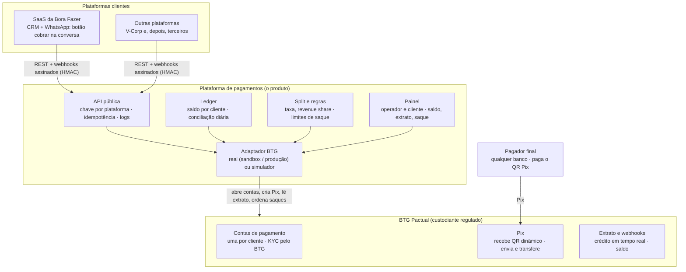

# Roteiro do MVP — Plataforma de Pagamentos (BTG BaaS)

Oct 23, 2026 · @Rodrigo Zaneti

## O que o MVP precisa provar

Um cliente de uma plataforma SaaS recebe um Pix de qualquer banco, vê o saldo no painel da plataforma, saca para a conta que quiser, e a plataforma reteve a taxa e o split automaticamente: tudo por API, com a conta de pagamento aberta no BTG em nome do cliente, sem a plataforma tocar no dinheiro. Isso é o modelo 2 (BaaS do BTG) e é a única coisa que a demo precisa mostrar.

A demo tem dois públicos e um argumento para cada:

| Público | O que precisa ver | O que decide depois |
| --- | --- | --- |
| V-Corp (sócia-investidora) | Que o produto funciona de ponta a ponta, que o risco regulatório fica com o BTG e que a receita é por transação, não só por assinatura | Entrar na sociedade e financiar o time e a homologação |
| BTG (convênio) | Que a plataforma traz contas novas de PMEs e volume de Pix para dentro do banco, com onboarding e KYC no padrão deles | Liberar o BaaS com abertura de contas via API e o sandbox |

**Critério de sucesso da demo**: em menos de 10 minutos, ao vivo, três transações reais no sandbox do BTG (ou no simulador, se o sandbox não vier a tempo): uma cobrança Pix paga, um split para a Bora Fazer e um saque para outro banco, todas aparecendo no painel e no extrato por API.

**O que o MVP não é**: não é instituição de pagamento, não guarda dinheiro de terceiros e não emite cartão. Quem segura o saldo é o BTG.

## Pré-requisitos com o BTG: o caminho crítico

O MVP depende de uma única coisa fora do seu controle: o BTG abrir contas de pagamento em nome dos seus clientes via API. Tudo o mais dá para construir em paralelo. A primeira semana é para transformar o convênio numa lista fechada de acessos.

O BTG tem um portal de desenvolvedores de pagamentos ([developer.btgpactual.com](https://developer.btgpactual.com/)), e os ERPs integrados hoje (Omie, Senior, Kobana) usam OAuth por consentimento do cliente, com `client_id` e `client_secret`, escopos por produto (ex.: `bank-slips`), token de 24 h e webhooks de Pix e boleto ([Senior](https://documentacao.senior.com.br/seniorxplatform/manual-do-usuario/erp/Banking/ativacao-parceiros/onboarding-btg.htm), [Kobana](https://www.kobana.com.br/en/integrations/banks/btg)). Esse é o modelo 1. O que o MVP precisa a mais é o BaaS.

**O que pedir ao BTG, nesta ordem de importância**

| # | Pedido | Por que importa | Se o BTG disser não |
| --- | --- | --- | --- |
| 1 | Abertura de conta de pagamento PJ via API, em nome do cliente da plataforma, com KYC do BTG | É o modelo 2 inteiro: sem isso o cliente tem que abrir conta BTG por fora | Lançar no modelo 1 (consentimento) e manter o pedido como condição da fase 2 |
| 2 | Pix recebimento com QR dinâmico (API Pix padrão BCB: `cob`, `cobv`, webhook de pagamento) | Cobrança principal do MVP | Inaceitável: sem Pix não há produto |
| 3 | Pix envio (saque do cliente para qualquer banco) por API, com limites e dupla aprovação configuráveis | O "saque" do painel | Saque manual pelo app BTG na demo; automatizar depois |
| 4 | Transferência entre contas BTG por API (split: cliente → Bora Fazer, cliente → plataforma) | Split automático e sua receita | Split via Pix envio; mais custo e latência |
| 5 | Extrato e saldo por API, com webhook de crédito | Conciliação em tempo real e saldo no painel | Polling de extrato a cada minuto |
| 6 | Boleto registrado com QR Pix no mesmo documento | Clientes B2B que ainda pagam boleto | Fica para a fase 2 |
| 7 | Sandbox com dados fictícios e credenciais de homologação | Construir e demonstrar antes do contrato final | Simulador próprio (seção de riscos) |
| 8 | Modelo comercial: remuneração por conta aberta e por volume, custo por Pix, prazo de homologação | Entra no plano financeiro da V-Corp | Hipóteses marcadas no documento até resposta |
| 9 | Papel da V-Corp no convênio: ela é a contratante do BaaS ou a plataforma é | Define quem assina, quem responde ao BTG e a estrutura societária | Decidir com o jurídico antes de assinar |

**Perguntas que o BTG vai fazer, e que é bom levar respondidas**

- Quem são os clientes finais (PMEs de 2 a 20 vendedores, carteira da Bora Fazer) e qual o volume esperado em 12 meses.
- Como a plataforma faz onboarding, guarda documentos e trata LGPD.
- Quem é o responsável técnico e de segurança (nome, não cargo).
- Qual o plano se um cliente tiver fraude ou chargeback: a plataforma bloqueia o saque? Em quanto tempo?

Ponto em aberto: o que o convênio atual com o BTG já cobre por escrito. Se for só relacionamento comercial, a reunião da semana 1 é para pedir os itens 1, 2, 3 e 7 formalmente.

## Escopo do MVP

O MVP tem quatro peças: uma API pública que qualquer SaaS chama, um ledger que espelha o saldo de cada cliente, a integração com o BTG e um painel. Tudo que não serve à demo de 10 minutos fica fora.

**Entra**

1. **Onboarding do cliente por API**: a plataforma SaaS envia CNPJ, responsável e documentos; o MVP abre a conta de pagamento no BTG e devolve o status (pendente, aprovada, recusada) por webhook.
2. **Cobrança Pix**: `POST /charges` cria um QR dinâmico com valor, vencimento e referência externa (o ID do negócio no CRM); webhook `charge.paid` quando o pagador paga.
3. **Ledger e saldo**: cada crédito e débito vira lançamento imutável; saldo disponível, bloqueado e a liberar por cliente; conciliação diária com o extrato do BTG, com alerta se divergir.
4. **Split automático**: regra por plataforma (ex.: 1,5% para a plataforma, 25% da mensalidade para a Bora Fazer); executado no momento do crédito, com lançamentos separados e rastreáveis.
5. **Saque**: `POST /payouts` para uma chave Pix ou conta em qualquer banco; limite diário, aprovação em duas etapas acima de um valor, bloqueio se houver disputa aberta.
6. **Segurança**: chave de API por plataforma e token por cliente final; assinatura HMAC em todos os webhooks; idempotência por `Idempotency-Key`; trilha de auditoria de toda chamada; segredos do BTG em cofre, nunca no código.
7. **Painel**: dois papéis. Operador da plataforma vê todos os clientes, volume, splits e alertas de conciliação; cliente final vê saldo, extrato, cobranças e pede saque.
8. **Plugin na plataforma da Bora Fazer**: botão "cobrar" dentro da conversa do WhatsApp gera o Pix; o pagamento move o negócio no pipeline. É a demo de ponta a ponta.
9. **Simulador do BTG**: adaptador que imita as respostas do banco (abertura de conta, Pix pago, extrato) para desenvolver e demonstrar sem depender do sandbox.

**Fica fora (fase 2 em diante)**

- Boleto, cartão e maquininha (BTG Pay), Pix Automático e assinatura recorrente.
- Antecipação de recebíveis e crédito (produto do BTG, oferecido dentro do painel depois).
- Disputa e estorno automatizados (no MVP, estorno é manual pelo operador).
- App nativo, multi-moeda, nota fiscal, cobrança por e-mail.
- Abertura para plataformas de terceiros: o MVP serve a Bora Fazer e a V-Corp; o marketplace de integrações vem depois da licença de uso com o BTG.

**Regra de corte**: se um item não aparece na demo de 10 minutos e não é exigido pelo BTG para homologar, não entra.

## Arquitetura

*A plataforma orquestra; o BTG segura o dinheiro.*

O dinheiro vai do pagador direto para a conta BTG do cliente; a plataforma só lê, calcula e ordena. O adaptador é a única peça que fala com o banco, e por isso pode ser trocado pelo simulador sem mudar o resto.

**Fluxo de uma cobrança, passo a passo**

1. O vendedor clica em "cobrar" na conversa do WhatsApp; o SaaS chama `POST /charges` com valor, cliente e ID do negócio.
2. A API valida a chave da plataforma, registra a intenção no ledger (status `pending`) e pede ao BTG um QR dinâmico na conta do cliente.
3. O SaaS envia o QR na conversa; o pagador paga de qualquer banco.
4. O BTG credita a conta do cliente e dispara o webhook; o adaptador confere a assinatura e grava o crédito no ledger.
5. O motor de split cria os lançamentos (taxa da plataforma, fatia da Bora Fazer) e ordena as transferências entre contas BTG.
6. A API dispara `charge.paid` para o SaaS, que move o negócio no pipeline; o painel mostra o saldo novo.
7. Na conciliação diária, o ledger é comparado ao extrato do BTG; qualquer diferença vira alerta para o operador.

**Decisões técnicas para o MVP**

| Decisão | Escolha | Motivo |
| --- | --- | --- |
| Ledger | Partidas dobradas, lançamentos imutáveis, saldo derivado | Auditoria e conciliação exigem histórico; saldo "editado" é o erro clássico |
| Idempotência | `Idempotency-Key` obrigatória em toda escrita | Webhook duplicado ou retry não pode cobrar duas vezes |
| Segredos | Cofre (Vault, AWS Secrets Manager ou equivalente); rotação de chaves | Exigência do BTG na homologação |
| Multi-tenant | Isolamento por plataforma e por cliente desde a primeira tabela | Mudar depois custa uma migração de dados financeiros |
| Filas | Processamento assíncrono de webhooks e splits | O banco não espera; a resposta ao webhook tem que ser imediata |
| Observabilidade | Log estruturado de cada chamada ao BTG, com correlação por transação | A primeira pergunta do BTG num incidente é "o que vocês mandaram e quando" |
| LGPD | Consentimento no onboarding, minimização de dados, exportação e exclusão | Dados de CNPJ e sócios são dados pessoais |

Stack sugerida, sem compromisso: API em Node ou Python (FastAPI), Postgres para o ledger, Redis ou SQS para filas, painel web em React. O que importa é o ledger e o adaptador, não a linguagem.

## Fases e cronograma

Doze semanas, quatro fases, um portão ao fim de cada uma. O simulador do BTG é o que permite construir as fases 1 e 3 mesmo que o sandbox atrase; a fase 2 é a única que depende do banco.

```mermaid
flowchart LR
    F0["Fase 0 · Fundações<br/>semanas 1–2<br/>BTG, infra, ledger"]
    G1{{"Portão 1<br/>BTG confirma BaaS e sandbox"}}
    F1["Fase 1 · Core<br/>semanas 3–6<br/>API, split, simulador"]
    G2{{"Portão 2<br/>fluxo completo no simulador"}}
    F2["Fase 2 · Integração<br/>semanas 7–9<br/>sandbox BTG, painel"]
    G3{{"Portão 3<br/>3 transações reais no sandbox"}}
    F3["Fase 3 · Demo e piloto<br/>semanas 10–12<br/>plugin e demo V-Corp"]
    G4{{"Portão 4<br/>demo V-Corp e decisão de investir"}}
    F0 --> G1 --> F1 --> G2 --> F2 --> G3 --> F3 --> G4
    style F3 fill:#dbeafe,stroke:#2563eb,stroke-width:2px
    style G4 fill:#2563eb,color:#fff,stroke:#2563eb
```

*Doze semanas e quatro portões até a decisão da V-Corp.*

Cada portão é uma decisão de seguir, ajustar ou parar; o último é a apresentação à V-Corp com o produto rodando.

| Fase | Semanas | Entregas | Quem |
| --- | --- | --- | --- |
| 0 · Fundações | 1–2 | Reunião com o BTG com a lista de pedidos; carta de intenções com a V-Corp; repositório, infra, cofre de segredos; modelo do ledger e da API (OpenAPI) revisados | Você + jurídico; 1 dev sênior |
| 1 · Core | 3–6 | API pública (charges, payouts, webhooks); ledger de partidas dobradas com conciliação; motor de split; simulador do BTG; testes automatizados de ponta a ponta | 2 devs (1 back-end sênior, 1 full-stack) |
| 2 · Integração | 7–9 | Adaptador real contra o sandbox do BTG (abertura de conta, Pix QR, webhook, extrato, saque); painel do operador e do cliente; onboarding com documentos | 2 devs + contato técnico do BTG |
| 3 · Demo e piloto | 10–12 | Botão "cobrar" na plataforma da Bora Fazer; roteiro e ensaio da demo; apresentação à V-Corp; 3 clientes da Bora Fazer em piloto com valores baixos | Você + 1 dev; Bora Fazer nos clientes |

Se o BTG liberar o sandbox só depois da semana 6, a fase 2 desliza e a demo da semana 12 roda no simulador, com o sandbox como próxima entrega. A seção de riscos detalha esse plano B.

## Roteiro da demo para a V-Corp

Quinze minutos, produto rodando ao vivo, slides só para os números. A V-Corp precisa sair da sala tendo visto dinheiro entrar, ser dividido e sair, e tendo entendido por que o risco regulatório não é seu.

| Min | Passo | O que mostrar | O que dizer |
| --- | --- | --- | --- |
| 0–2 | A dor | Tela de um CRM comum: venda fechada no WhatsApp, cobrança feita por fora, planilha de conciliação | "A PME vende no WhatsApp e recebe por Pix na mão; ninguém sabe quem pagou o quê. Toda plataforma SaaS tem esse buraco e nenhuma quer virar banco para fechá-lo" |
| 2–4 | O mercado | Um slide: PagSeguro, Pagar.me, Asaas são IPs licenciadas; Res. 494 fechou a porta para entrar sem licença; BTG lançou o BTG Pay e quer canais | "O jeito de entrar hoje é em cima de um banco. Nós temos o BTG" |
| 4–9 | A demo | Ao vivo, no sandbox ou simulador: (1) onboarding de um cliente novo por API, conta aprovada; (2) botão "cobrar" na conversa da plataforma da Bora Fazer gera o QR; (3) pagamento do QR pelo celular; (4) webhook chega, saldo sobe, split aparece em três linhas no ledger; (5) cliente pede saque para outro banco; (6) negócio muda de etapa no CRM sozinho | Narrar o que acontece em cada tela; apontar que em nenhum momento o dinheiro passou pela plataforma |
| 9–11 | A arquitetura | O diagrama deste documento | "Somos software e API. O BTG é o custodiante. Isso é o que mantém o custo de conformidade perto de zero" |
| 11–13 | O negócio | Take rate, receita por conta e por volume, primeiras plataformas (Bora Fazer, V-Corp), caminho para terceiros | "Receita que cresce com o faturamento dos clientes, não com assentos" |
| 13–15 | O pedido | Valor, uso do capital (time, homologação, piloto), próximos 90 dias, papel da V-Corp no convênio BTG | Uma pergunta só: entram? |

**Preparação que não pode faltar**

- Ensaiar a demo três vezes com dados limpos; ter uma gravação em vídeo como reserva se a internet ou o sandbox falharem.
- Dois celulares: um com o WhatsApp da "PME", outro com o app bancário do "pagador".
- O painel aberto numa segunda tela, mostrando o ledger em tempo real.
- Os números do piloto da Bora Fazer, se já houver: cobranças emitidas, tempo médio até o pagamento, volume.
- Resposta pronta para as três perguntas que vão vir: "e se o BTG mudar de ideia?", "quem responde se um cliente for fraudador?" e "por que não usar o Asaas?".

**Respostas curtas para essas três perguntas**

- BTG muda de ideia: o adaptador isola o banco; migrar para outro BaaS (QI Tech, Celcoin, Dock) é trabalho de integração, não de produto. O contrato com o BTG deve prever prazo de aviso.
- Fraude: o KYC é do BTG; a plataforma bloqueia saque em caso de disputa e mantém trilha de auditoria completa. A responsabilidade segue o desenho do contrato de BaaS, a ser definido com o jurídico.
- Por que não Asaas: o Asaas é concorrente das plataformas, cobra take rate cheio e fica com o cliente. Aqui a plataforma é dona da relação, do take rate e dos dados, e o BTG ganha a conta.

## Time, custo e modelo de receita

O MVP custa perto de R$ 150 mil em 12 semanas, quase tudo em gente; o custo do BTG é a hipótese que mais precisa de confirmação. Os valores abaixo são ponto de partida para a conversa com a V-Corp, não orçamento fechado.

**Time e custo do MVP (12 semanas)**

| Item | Dimensão | Custo estimado (R$) | Observação |
| --- | --- | --- | --- |
| Dev back-end sênior (ledger, API, adaptador) | 12 semanas | 60.000 | PJ, dedicação integral |
| Dev full-stack (painel, plugin na Bora Fazer, simulador) | 10 semanas | 40.000 | PJ |
| Você (produto, BTG, V-Corp, arquitetura) | 12 semanas | 0 em caixa | Equity |
| Jurídico regulatório e contrato de BaaS | pontual | 15.000 a 30.000 | Escritório com experiência em IP e BaaS |
| Infra (cloud, cofre de segredos, monitoramento) | 3 meses | 3.000 | Cresce com o volume depois |
| Segurança: pentest antes da homologação | pontual | 10.000 a 20.000 | O BTG tende a exigir |
| Reserva |  | 15.000 | Atrasos do sandbox, retrabalho |
| **Total** |  | **145.000 a 170.000** |  |

**Modelo de receita (hipóteses para validar com o BTG e no piloto)**

| Fonte | Hipótese | De onde vem o número |
| --- | --- | --- |
| Take rate sobre Pix recebido | 0,8% a 1,2% por transação, com teto de R$ 5 | Pix é barato para o banco; o valor fica abaixo do débito (1% a 2%) e muito abaixo do cartão |
| Custo do BTG por Pix | R$ 0,10 a 0,50 por transação (a confirmar) | Faixa praticada por BaaS no mercado; pedido 8 da lista ao BTG |
| Mensalidade por plataforma conectada | R$ 500 a 2.000 por mês por plataforma | Cobre suporte, painel e SLA; a Bora Fazer entra sem mensalidade no piloto |
| Remuneração do BTG por conta aberta ou por volume | a negociar | Depende do convênio; pode zerar o custo por Pix |
| Fase 2: antecipação de recebíveis e crédito | Comissão sobre produto do BTG | Não entra no MVP |

**Ordem de grandeza para a V-Corp**: 50 clientes PME com R$ 40 mil por mês em Pix cada um são R$ 2 milhões de volume mensal; a 1% de take rate, R$ 20 mil por mês de receita de transação, mais mensalidades das plataformas. Com 500 clientes (a carteira da Bora Fazer mais duas ou três plataformas), R$ 200 mil por mês. A margem depende do custo por Pix do BTG, por isso ele é o número mais importante a fechar antes do pitch.

Ponto em aberto: se a V-Corp é quem contrata o BaaS, parte dessa receita pode ser dela por contrato e não por participação; definir no acordo societário.

## Riscos, dependências e plano B

O maior risco é o BTG: não liberar o BaaS, ou liberar tarde. O simulador existe para que esse risco atrase a integração, não a demo.

| Risco | Probabilidade | Impacto | Resposta |
| --- | --- | --- | --- |
| BTG não oferece abertura de conta via API (BaaS) | média | alto | Lançar no modelo 1 (cliente abre conta BTG e dá consentimento OAuth); demo roda igual, só o onboarding muda. Em paralelo, cotar QI Tech, Celcoin e Dock como BaaS alternativo atrás do mesmo adaptador |
| Sandbox do BTG chega depois da semana 6 | alta | médio | Demo da semana 12 no simulador, com vídeo do fluxo real assim que o sandbox abrir; a V-Corp vê o produto, e a integração vira marco pós-investimento |
| Homologação de segurança do BTG mais exigente que o previsto | média | médio | Pentest e cofre de segredos desde a fase 0; checklist de segurança pedido ao BTG na semana 1 |
| Jurídico conclui que algum fluxo (split, saldo no painel) caracteriza IP | baixa | alto | Saldo exibido é o saldo da conta BTG do cliente, lido por API, nunca um saldo próprio; split executado como transferências entre contas BTG. Validar o desenho com o escritório antes da fase 1 |
| BTG muda preço ou encerra o convênio | baixa | alto | Contrato com aviso prévio; adaptador isola o banco; segundo BaaS cotado |
| Fraude ou disputa num cliente do piloto | média | médio | Valores baixos no piloto, bloqueio de saque em disputa, trilha de auditoria; responsabilidade definida no contrato de BaaS |
| Plataforma da Bora Fazer não está pronta para o plugin | média | baixo | O botão "cobrar" vira uma tela demonstrativa que chama a mesma API; o CRM real entra depois |
| Convênio BTG fica em nome da V-Corp e a sociedade não se concretiza | baixa | alto | Carta de intenções antes da fase 0 define o que acontece com o convênio e o código se a V-Corp não entrar |

**Dependências externas, em ordem de data**

1. Jurídico: parecer sobre o desenho (modelo 2) antes da fase 1.
2. BTG: confirmação do BaaS e credenciais de sandbox até o fim da semana 2 (portão 1).
3. V-Corp: carta de intenções assinada antes de contratar os devs.
4. Bora Fazer: 3 clientes dispostos ao piloto até a semana 9.
5. Meta Cloud API: número de WhatsApp da demo ativo (já previsto na proposta da Bora Fazer).

**O que o plano B não resolve**: se o jurídico ou o BTG disserem que nem o modelo 1 nem o 2 são viáveis no convênio atual, o produto precisa de outro BaaS ou de licença própria, e a conversa com a V-Corp muda de "MVP em 12 semanas" para "rodada para licença". Esse cenário deve estar nomeado no pitch, não escondido.

## Próximos passos

A próxima semana é toda sobre o BTG e o papel: nada de código antes do portão 1 estar encaminhado.

- [ ] Levantar por escrito o que o convênio atual com o BTG cobre e quem é o contato técnico e o comercial
- [ ] Marcar a reunião com o BTG e levar a tabela de 9 pedidos; sair com data para o sandbox
- [ ] Pedir acesso ao portal [developer.btgpactual.com](https://developer.btgpactual.com/) e ler a documentação de Pix, contas e webhooks
- [ ] Contratar parecer jurídico sobre o modelo 2 (BaaS) e sobre o papel da V-Corp no convênio
- [ ] Escrever a carta de intenções com a V-Corp: participação, capital do MVP, dono do convênio, o que acontece se não seguir
- [ ] Definir nome e marca do produto (a plataforma de pagamentos, separada da plataforma de vendas)
- [ ] Selecionar o dev back-end sênior; critério: já ter construído ledger ou integração bancária
- [ ] Escrever o OpenAPI da API pública (charges, payouts, accounts, webhooks) para revisão com a Bora Fazer e a V-Corp
- [ ] Confirmar com a Bora Fazer os 3 clientes do piloto e o momento de incluir o botão "cobrar" no roadmap delas

**Decisões a tomar com a V-Corp antes da fase 1**

- Duas empresas (pagamentos e vendas com IA) ou uma holding: a recomendação é duas, com cap tables separados.
- Quem assina o contrato de BaaS com o BTG: a nova empresa, a V-Corp ou você.
- Se a V-Corp usa o produto nas próprias plataformas desde o MVP (segunda plataforma conectada) ou só investe.

## Fontes

Consultadas em 23/10/2026. Preços, prazos e custos do BTG são hipóteses até confirmação por escrito.

- [BTG Developer Portal (Payments)](https://developer.btgpactual.com/)
- [Senior: onboarding BTG (OAuth, escopos, webhooks)](https://documentacao.senior.com.br/seniorxplatform/manual-do-usuario/erp/Banking/ativacao-parceiros/onboarding-btg.htm) · [Omie: integração BTG boletos e Pix via API](https://ajuda.omie.com.br/pt-BR/articles/11419274-configurando-a-integracao-com-o-btg-pactual-boletos-pix-via-api) · [Kobana: integração BTG](https://www.kobana.com.br/en/integrations/banks/btg)
- [Startups.com.br: BTG Pay e bandeira própria B2B](https://startups.com.br/negocios/btg-pactual-bandeira-propria-de-cartao-para-abrir-mercado-b2b-de-r-50-trilhoes/)
- [Capital Aberto: Resoluções BCB 494 e 495](https://capitalaberto.com.br/regulacao/legislacao-mercados/2025/12/mudancas-estruturais-no-regime-de-autorizacao-de-instituicoes-de-pagamento-as-resolucoes-494-e-495-do-banco-central) · [Resolução BCB 494 (texto)](https://www.legisweb.com.br/legislacao/?id=483156)
- [BCB: API Pix (padrão de cobrança e webhooks)](https://github.com/bacen/pix-api)
- Proposta Bora Fazer — Plataforma de Vendas com IA (documento deste projeto, 22/10/2026)
